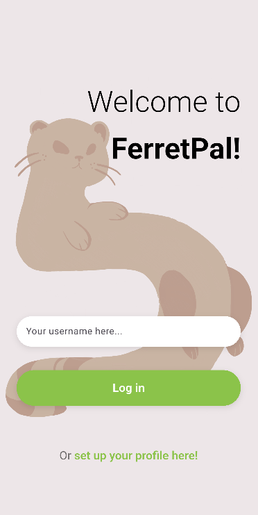
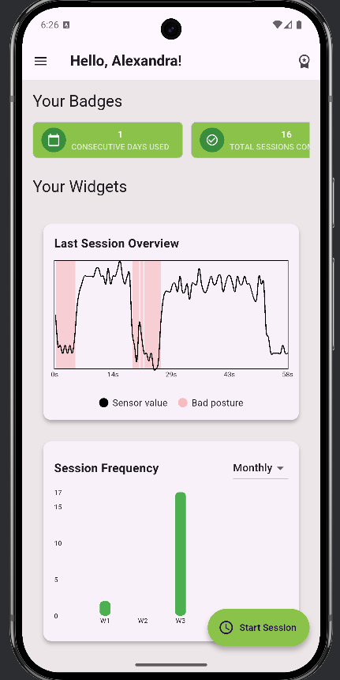

# FerretPal -Flutter &amp; Arduino Posture Tracker

FerretPal is a wearable IoT prototype and companion mobile application designed to monitor posture in real time. Flex sensors connected to an Arduino UNO R3 capture posture-related measurements, which are collected and processed by a Python backend. The Flutter mobile app displays posture data and provides audio-visual alerts when posture deviates from the user's configured threshold.

FerretPal was developed as a Bachelor's project to explore the integration of wearable hardware, sensor-based data acquisition, backend communication, and mobile application development in a practical IoT solution.

# Features
- Wearable posture monitoring
- Real-time data acquisition
- Backend API
- Mobile dashboard
- Audio-visual feedback
- Personalized monitoring

# Screenshots
<p align="center">
  
  
</p>

# System Overview
FerretPal consists of three main components:
1. Hardware: Flex sensors connected to an Arduino UNO R3 measure posture-related changes.
2. Python backend: PySerial is used for data acquisition, while Flask provides API communication.
3. Flutter mobile application: The app communicates with the backend, visualizes posture measurements, and presents alerts to the user.
 ```
Flex Sensors
     │
     ▼
Arduino UNO R3
     │
     ▼
Python Backend
(PySerial + Flask)
     │
     ▼
Flutter Mobile App
     │
     ├── Posture visualizations
     └── Audio-visual alerts
```

# Tech Stack
- Hardware: Arduino UNO R3, flex sensors
- Data acquisition: Python, PySerial
- Backend: Flask
- Mobile application: Flutter, Dart
- Communication: HTTP,
- Project domain: IoT, posture monitoring

# Repository Structure
The repository is organized into the mobile application and backend components:
```
FerretPal/
├── ferret_pal/       # Flutter mobile application
├── flask_server/     # Python backend
└── README.md
```

# Getting started!
FerretPal requires the hardware, Python backend, and Flutter application to work together.
Prerequisites
- Arduino UNO R3
- Flex sensors and the required circuit components
- Python
- Flutter SDK
- Dart (included with Flutter)
- A device or emulator supported by Flutter

Setup
1. Clone the repository:
```
git clone https://github.com/codralexandra/FerretPal.git
cd FerretPal
```
2. Set up the hardware. Connect the flex sensors to the Arduino UNO R3 according to your circuit configuration.
3. Set up the Python backend. Navigate to flask_server/, install the backend dependencies, and configure the serial connection to match your Arduino's port.
4. Start the backend. Run the Flask server using the project's backend entry point.
5. Set up the Flutter application. Navigate to ferret_pal/ and fetch the Flutter dependencies:
```
flutter pub get
```
6. Configure the app's API connection to point to the running Flask backend.
7. Run the mobile app:
```
flutter run
```
